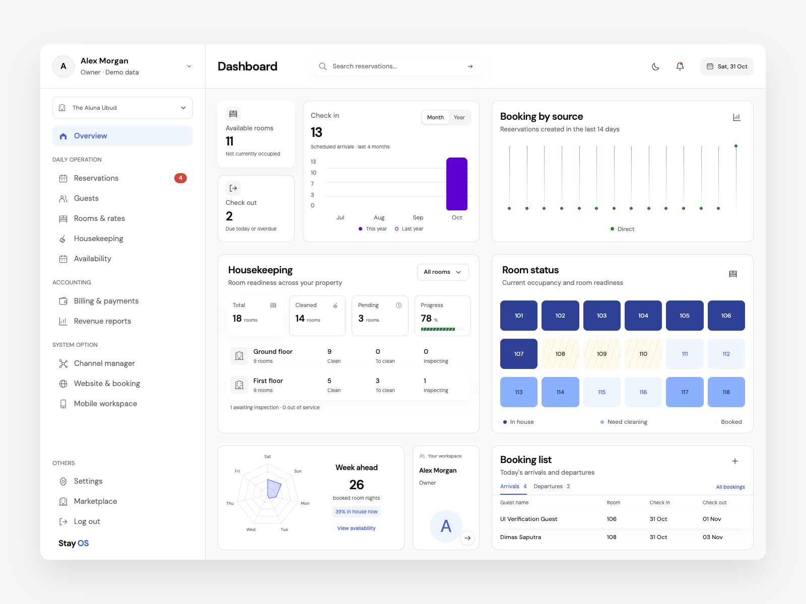
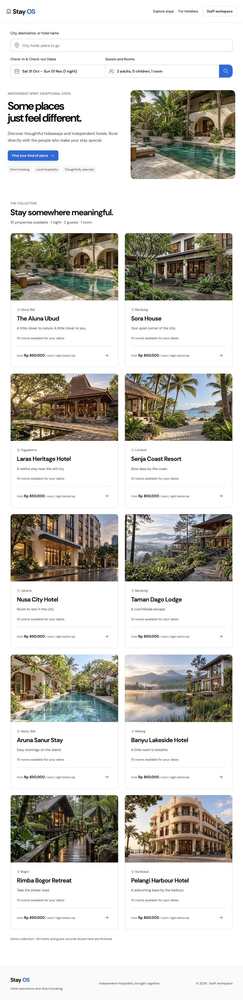
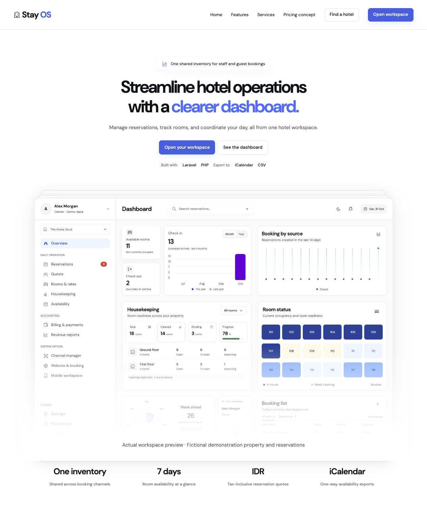
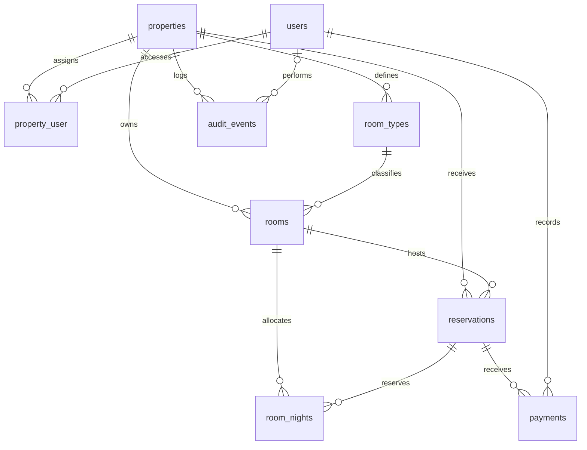

# Stay OS

A custom hotel operations and direct-booking platform targeting **Laravel 13 / PHP 8.3+**. It uses Blade, session authentication, plain CSS and JavaScript, and a single shared inventory for the staff workspace and public booking website. No Node build step is required.

## Screenshots

Desktop views of the application using fictional demonstration properties and records.

### Dashboard

Staff workspace at `/app`, showing arrivals, room availability, housekeeping readiness, and bookings.



### Marketplace

Hotel marketplace at `/`, with city/hotel-name search, stay dates, guests and rooms, and a distinct AI-generated image for each of the ten demonstration hotels.



### Product home

Product landing page at `/product`, showing the introduction and dashboard preview.



## Current verification status

The application has been booted locally with PHP 8.5.8 and Laravel 13.39.0. All 33 automated tests (135 assertions), 22 standalone domain checks, Composer manifest validation, route discovery, Blade compilation, and JavaScript syntax checks passed. Browser checks verified staff navigation, themes, chart controls, mobile menus, search, authentication, and a guest booking through confirmation. The white/blue UI follows `DESIGN.md`; `/product` presents the product while `/` retains the hotel marketplace. Product screenshots and pricing examples are labeled demonstration content. See [UI revamp verification](anti-slop/revamp-delivery-2026-10-31.md) for evidence and reference adaptations. Composer dependencies are installed locally; `vendor` remains excluded from source distribution. The automated suite also passed against Docker PostgreSQL 17 in the separate `stayos_testing` database (33 tests, 135 assertions). HTTP checks confirmed the marketplace lists all ten demo hotels and a new hotel page responds successfully. Production integrations and concurrent booking behavior remain unverified.

## One-step local launcher (macOS)

Double-click `start-local.command` in Finder, or run `./start-local.command` in your Mac terminal. It installs dependencies using a writable project-local cache, initializes the environment/key/database without replacing existing data, starts Docker PostgreSQL when configured, compiles Blade views, lists routes, and runs the development server in the foreground. Composer needs internet access. The launcher is intended for local development only.

## Run locally

Requirements: PHP 8.3+ with Laravel's required extensions plus PDO PostgreSQL, Composer 2, and Docker Desktop. Development defaults to PostgreSQL 17 in Docker, exposed only at `127.0.0.1:5433`. SQLite and MySQL connections are also configured. The application runs directly on your machine.

```sh
cp .env.example .env
```

Edit `.env` and set `DEMO_ADMIN_PASSWORD` to a password of at least 12 characters. Then:

```sh
composer install
php artisan key:generate
docker compose up -d --wait postgres
php artisan migrate --seed
php artisan serve --host=127.0.0.1 --port=8000
```

Keep the last command running in your terminal. Open:

- Staff workspace: http://127.0.0.1:8000/app
- Marketplace: http://127.0.0.1:8000
- Product home: http://127.0.0.1:8000/product
- Example hotel: http://127.0.0.1:8000/hotels/the-aluna-ubud

Local demo users all use your `DEMO_ADMIN_PASSWORD`:

| Account | Role |
| --- | --- |
| `admin@stayos.test` | Owner, assigned to all ten demo properties |
| `desk@stayos.test` | Front desk, assigned to all ten demo properties |
| `housekeeping@stayos.test` | Housekeeping, assigned only to The Aluna Ubud |

Seed data includes ten fictional properties, 180 rooms, 140 sample reservations and manual receipts. Marketplace and hotel booking images are AI-generated photorealistic demonstration scenes, not photographs of actual properties. Generation prompts and asset details are in `docs/marketplace-images.md`. Contact details and guest records are fictional. Seeding is limited to local/testing and adds only missing demo hotel slugs, preserving existing hotels and staff credentials.

### Local PostgreSQL database

Laravel runs on the host and connects to the PostgreSQL service defined in [`compose.yaml`](compose.yaml). The database runs in Docker; the web application does not run inside that container.

| Setting | Local value |
| --- | --- |
| Image | `postgres:17` |
| Host and published port | `127.0.0.1:5433` (container port `5432`) |
| Database / user | `stayos` / `stayos` |
| Password | `DB_PASSWORD` in the ignored `.env` file |
| Storage | Compose volume `postgres_data` (`hotelmanagementsystem_postgres_data` for this checkout) |
| Test database | `stayos_testing`, separate from application data |
| Seed records | 10 hotels, 30 room types, 180 rooms, 140 reservations, 140 manual payments |

The `DB_*` values in `.env.example` match the Compose service. Keep `.env` local; it contains the application key and database credentials. PostgreSQL reads its initial database/user/password settings only when initializing an empty volume, so changing `.env` alone does not rotate credentials in an existing database.

The named Docker volume `postgres_data` persists across container restarts. Run `docker compose stop postgres` to stop it and `docker compose up -d --wait postgres` to start it again. `docker compose down` retains data; adding `-v` deletes the database volume. Existing SQLite files are left intact and are not imported into PostgreSQL.

Demo hotels: The Aluna Ubud (Bali), Sora House (Bandung), Laras Heritage Hotel (Yogyakarta), Senja Coast Resort (Lombok), Nusa City Hotel (Jakarta), Taman Dago Lodge (Bandung), Aruna Sanur Stay (Bali), Banyu Lakeside Hotel (Malang), Rimba Bogor Retreat (Bogor), and Pelangi Harbour Hotel (Surabaya). Each has three room types, 18 rooms, 14 sample reservations, and its own property image. Images are static project assets mapped by hotel slug in `config/marketplace.php`; image binaries are not stored in PostgreSQL. Re-running `php artisan db:seed` adds only missing demo hotels without replacing existing property records, reservations, or staff credentials.

For an empty installation without demo data, use `php artisan migrate`, then `php artisan stayos:owner`. This command prompts for owner credentials and creates an initial unpublished property. Owners can add properties and staff through Settings. Staff account editing, password recovery, and access revocation need to be added before wider rollout.

## Modules

| Requested module | Implemented source | Still to build |
| --- | --- | --- |
| Property management | Multiple properties, staff roles and assignments, rooms and rates, reservation creation/search, seven-day availability, check-in/out, room readiness, guests, manual payments, printable invoices, reports and audit events | Seasonal rates, group bookings, room moves, night audit, refunds, inventory/POS, richer accounting |
| Booking engine | Date/guest search, live database availability, server-side quote, room reservation, private confirmation page | Online payments, email confirmation, cancellation rules, quote expiry, add-ons |
| Hotel website | Public hotel page, rooms, amenities, contact details and editable property content; publishing toggle | Photo uploads, themes, pages, custom domains and content editor |
| Channel manager | Private one-way room iCalendar availability feeds and reservation CSV export | Provider-approved OTA APIs, inbound reservations, rate/inventory pushes, mapping, retries, reconciliation and monitoring |
| Mobile app | Responsive staff screens and a home-screen web manifest | Native iOS/Android apps, mobile API authentication, push notifications, offline operation |
| Marketplace | Published multi-property directory, destination search, rate display and direct property booking | Owner self-onboarding, commissions, payouts, moderation, reviews and marketplace payments |

This is a first implementation, not a production-complete hospitality suite. OTA feeds do not provide two-way or real-time synchronization. No OTA connection, payment gateway, email delivery or native app is represented as active.

## Database design

The application uses a relational database shared by the staff workspace and public booking website. Docker PostgreSQL is the local default; PostgreSQL is the preferred production target, and MySQL is also configured. The schema source of truth is [the hotel platform migration](database/migrations/2026_10_31_000001_create_hotel_platform.php); connection settings are in [config/database.php](config/database.php).

### Entity relationships



Each child row belongs to one parent on each required foreign key. An audit event may have no user, such as a public booking. `property_user` implements the many-to-many relationship between staff and properties.

### Tables and fields

All tables except `property_user` have an auto-incrementing bigint `id` primary key. All except `property_user` and `room_nights` include nullable `created_at` and `updated_at` timestamps. Other fields are required unless marked nullable below. Types describe the Laravel migration; physical types depend on the database driver.

| Table | Fields and purpose |
| --- | --- |
| `users` | Staff identity: `name`, unique `email`, hashed `password`, `role` (default `frontdesk`), nullable `remember_token`. Roles used by the application are `owner`, `manager`, `frontdesk`, and `housekeeping`. |
| `properties` | Hotel identity and public content: `name`, unique `slug`, `city`, `address`, text `description`, `tagline`, `email`, `phone`; three-character `currency` (default `IDR`), unsigned integer `tax_basis_points` (default `1100`, meaning 11%), boolean `published` (default `false`). |
| `property_user` | Staff access assignments: foreign keys `property_id` and `user_id`, together forming the composite primary key. Roles belong to the user globally, rather than to each assignment. |
| `room_types` | Foreign key `property_id`; `name`, text `description`, unsigned integer `capacity`, unsigned bigint `nightly_rate`, string `amenities`. Holds the current rate for new bookings. |
| `rooms` | Foreign keys `property_id` and `room_type_id`; string `number` and `floor`, `housekeeping_status` (default `clean`; application also accepts `dirty` and `inspecting`), boolean `out_of_service` (default `false`), unique `calendar_token` (string up to 64 characters). Room numbers are unique within a property. |
| `reservations` | Foreign keys `property_id` and `room_id`; unique `reference` and UUID `access_token`; `guest_name`, `guest_email`, nullable `guest_phone`, unsigned integer `guests`; dates `check_in` and `check_out`; `status` (default `confirmed`), `source` (default `direct`; staff bookings use `frontdesk`); unsigned bigint `nightly_rate`, `subtotal`, `tax`, `total`; nullable text `notes` and nullable timestamps `checked_in_at`, `checked_out_at`. |
| `room_nights` | Foreign keys `room_id` and `reservation_id`, plus date `night`. One row per allocated room and stay night; `(room_id, night)` is unique. These rows represent inventory allocations, not historical occupancy. |
| `payments` | Foreign keys `reservation_id` and `user_id` (staff recorder); unsigned bigint `amount`, `method` (`cash`, `bank_transfer`, or `card_terminal` in application validation), unique UUID `idempotency_key`, nullable string `note`. Records money already received. |
| `audit_events` | Foreign key `property_id`, nullable foreign key `user_id`, string `action` and `subject`. The subject is a descriptive value such as a reservation reference or room label, not a foreign key. |

Guest contact details are stored per reservation. The guest directory groups reservations by `guest_email` within the selected property; there is no separate `guests` table. Payments inherit their property through their reservation. Sessions and cache use files by default, so the application migration does not create session or cache tables. Laravel separately maintains its migration tracking table.

### Constraints and indexes

| Key or index | Purpose |
| --- | --- |
| Unique `users.email`, `properties.slug` | Prevent duplicate staff login addresses and public hotel URLs. |
| Primary key `property_user(property_id, user_id)` | Prevent duplicate property assignments. Both foreign keys cascade on parent deletion. |
| Unique `rooms(property_id, number)` | Allow the same room number at different properties while preventing duplicates within one hotel. |
| Unique `rooms.calendar_token`, `reservations.access_token`, `reservations.reference` | Keep calendar links, private confirmation links, and booking references distinct. |
| Unique `room_nights(room_id, night)` | Reject a second allocation for the same room and date; also supports availability lookups by room and night. |
| Index `reservations(property_id, check_in, check_out, status)` | Support property-scoped reservation date queries. |
| Unique `payments.idempotency_key` | Prevent duplicate receipt records for the same submission key. |

All declared foreign keys reference existing parent rows. Apart from the assignment pivot's two cascading foreign keys, the migration does not configure cascading deletes or set-null behavior. A nullable audit user does not imply that deleting its user automatically clears the reference.

### Marketplace search

The joined search bar accepts a city/destination or hotel name (case insensitive), a 1–90 night date range, adults, children, and rooms. Results include only published properties with operational rooms available for every requested night and enough combined capacity for the party across the requested number of rooms. At least one adult is required per room; children count toward capacity. Dates and group details carry into hotel links. Rates are starting nightly prices per room before tax, not a quote for the whole group. Multi-room reservations are currently made one room at a time, as explained on the search results and hotel pages.

### Inventory, pricing, and application rules

- **Night allocation:** [BookingService](app/Services/BookingService.php) locks the selected room inside a transaction, checks availability and capacity, then creates the reservation and one `room_nights` row for each date in `[check_in, check_out)`. The unique room/night constraint guards duplicate allocations. Cancellation and checkout delete allocations while retaining the reservation and receipts. Target-database concurrency still needs verification.
- **Price snapshots:** Money is stored as whole Indonesian rupiah in integer columns. At booking time, `nightly_rate`, `subtotal`, `tax`, and `total` are copied/calculated on the reservation. Tax uses the property's basis-point rate and rounds to the nearest rupiah; later rate or tax-setting changes do not reprice existing stays. Paid amount is the sum of payment rows, and balance is derived as `max(0, total - paid)`; neither is a stored reservation column.
- **Lifecycle:** Application code permits `confirmed` to become `checked_in` or `cancelled`, and `checked_in` to become `checked_out`. Payment recording locks the reservation, rejects overpayment and payments on cancelled bookings, and checks the receipt idempotency key.
- **Property boundaries:** Controllers scope staff access through `property_user` assignments and validate related resources within the selected property. Foreign keys enforce parent existence, but there are no composite constraints proving that a room, its type, and its reservation share a property. Property consistency, permitted role/status/method values, stay length, capacity, and lifecycle rules rely on application validation rather than database enums or check constraints.

## Important rules

- Amounts are integers in whole Indonesian rupiah. No floating-point money storage.
- Stay dates follow `[check_in, check_out)`, so departure day may be booked by the next guest. Maximum stay: 90 nights.
- Each reservation snapshots its nightly rate and tax. Later rate changes do not reprice existing stays.
- Transactions lock the room before allocating nights. A unique `(room_id, night)` index is the final inventory guard. PostgreSQL is the preferred production database. Concurrency behavior must be tested on the target database.
- Check-in requires a clean, operational room, no current occupant, and stay dates covering today.
- Checkout requires a zero balance, releases the inventory, and marks the room dirty.
- Cancellation releases inventory. It does **not** issue a refund; receipts remain recorded. Refunds and cancellation accounting are a future module.
- Manual payment recording accepts money already received; it never charges a card. Idempotency keys prevent the same submitted receipt being recorded twice.
- Out-of-service rooms cannot be booked. Future reservations must be moved or cancelled before placing a room out of service.
- All staff actions resolve the selected property through the authenticated user's assignments. Roles are global per user; property access is assigned separately.
- Booking confirmation and calendar URLs are private bearer links. Calendar feeds contain no guest details. Do not share these URLs publicly.

## Tests

```sh
php tests/domain-check.php
composer validate --no-check-publish
node --check public/assets/app.js
```

After installing dependencies:

```sh
php artisan test
php artisan route:list
php artisan view:cache
```

To run the same suite against Docker PostgreSQL, create a separate test database once, then use the PostgreSQL test configuration (credentials come from `.env`):

```sh
docker compose exec -T postgres createdb -U stayos stayos_testing
vendor/bin/phpunit --configuration phpunit.pgsql.xml
```

The PostgreSQL configuration uses only `stayos_testing`; its schema is reset during tests. The default `php artisan test` continues to use in-memory SQLite.

The feature suite covers public pages, staff pages, booking overlap/adjacency, rate snapshots, manual payments and replay protection, room readiness, checkout balances, property access, role restrictions, unpublished hotels, and calendar feed privacy. By default it uses an isolated in-memory SQLite test database.

## Project layout

- `app/Domain/Stay.php`: date, monetary quote and transition rules independent of Laravel.
- `app/Services/BookingService.php`: inventory allocation, stay lifecycle and audit records.
- `app/Http/Controllers`: public booking, staff operations and session authentication.
- `app/Models`: property, room, reservation and payment records.
- `database`: schema and local-only demo seeding.
- `resources/views`: staff workspace, hotel website, marketplace and printable documents.
- `public/assets`: shared design, browser interactions, generated hotel images and original SVG assets.
- `tests`: domain and Laravel feature tests.
- `docs/IMPLEMENTATION.md`: architecture, production gaps and integration plan.

## Production preparation

Complete the feature suite and browser QA; resolve any incompatibilities and keep `composer.lock` in version control. Use HTTPS, `APP_ENV=production`, `APP_DEBUG=false`, a unique `APP_KEY`, production contact details and a persistent database. Configure backups, monitoring, deployment and account lifecycle management. Replace sample content and verify local tax/invoice requirements, privacy notices and booking terms. See the implementation notes for the remaining work.

## License

Stay OS is licensed under the [MIT License](LICENSE). Third-party dependencies retain their respective licenses; the bundled DM Sans font includes its [SIL Open Font License](public/assets/fonts/OFL.txt).
