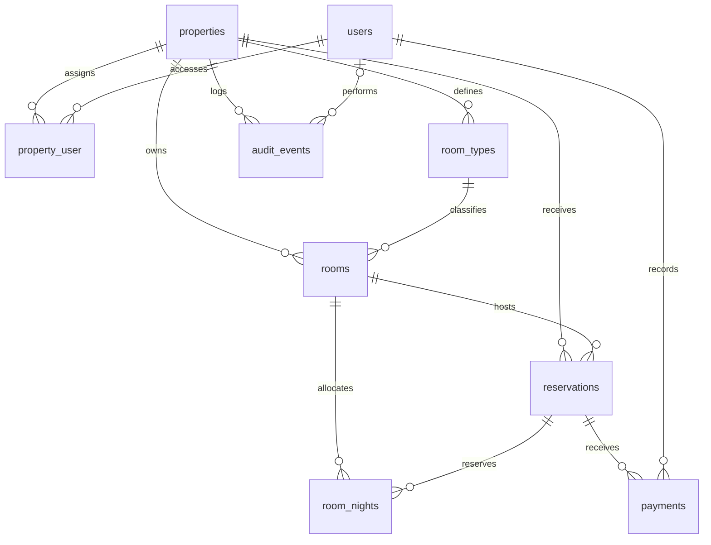

# Database

The application uses a relational database shared by the staff workspace and public booking website. Docker PostgreSQL is the local default; PostgreSQL is the preferred production target, and MySQL is also configured. The schema source of truth is [the hotel platform migration](../database/migrations/2026_10_31_000001_create_hotel_platform.php); connection settings are in [config/database.php](../config/database.php).

### Entity relationships

Each child row belongs to one parent on each required foreign key. An audit event may have no user, such as a public booking. `property_user` implements the many-to-many relationship between staff and properties.

### Tables and fields

All tables except `property_user` have an auto-incrementing bigint `id` primary key. All except `property_user` and `room_nights` include nullable `created_at` and `updated_at` timestamps. Other fields are required unless marked nullable below. Types describe the Laravel migration; physical types depend on the database driver.

| Table | Fields and purpose |
| --- | --- |
| `users` | Staff identity: `name`, unique `email`, hashed `password`, `role` (default `frontdesk`), nullable `remember_token`. Roles used by the application are `owner`, `manager`, `frontdesk`, and `housekeeping`. |
| `properties` | Hotel identity and public content: `name`, unique `slug`, `city`, `address`, text `description`, `tagline`, `email`, `phone`; three-character `currency` (default `IDR`), unsigned integer `tax_basis_points` (default `1100`, meaning 11%), boolean `published` (default `false`). |
| `property_user` | Staff access assignments: foreign keys `property_id` and `user_id`, together forming the composite primary key. Roles belong to the user globally, rather than to each assignment. |
| `room_types` | Foreign key `property_id`; `name`, text `description`, unsigned integer `capacity`, unsigned bigint `nightly_rate`, string `amenities`. Holds the current rate for new bookings. |
| `rooms` | Foreign keys `property_id` and `room_type_id`; string `number` and `floor`, `housekeeping_status` (default `clean`; application also accepts `dirty` and `inspecting`), boolean `out_of_service` (default `false`), unique `calendar_token` (string up to 64 characters). Room numbers are unique within a property. |
| `reservations` | Foreign keys `property_id` and `room_id`; unique `reference` and UUID `access_token`; `guest_name`, `guest_email`, nullable `guest_phone`, unsigned integer `guests`; dates `check_in` and `check_out`; `status` (default `confirmed`), `source` (default `direct`; staff bookings use `frontdesk`); unsigned bigint `nightly_rate`, `subtotal`, `tax`, `total`; nullable text `notes` and nullable timestamps `checked_in_at`, `checked_out_at`. |
| `room_nights` | Foreign keys `room_id` and `reservation_id`, plus date `night`. One row per allocated room and stay night; `(room_id, night)` is unique. These rows represent inventory allocations, not historical occupancy. |
| `payments` | Foreign keys `reservation_id` and `user_id` (staff recorder); unsigned bigint `amount`, `method` (`cash`, `bank_transfer`, or `card_terminal` in application validation), unique UUID `idempotency_key`, nullable string `note`. Records money already received. |
| `audit_events` | Foreign key `property_id`, nullable foreign key `user_id`, string `action` and `subject`. The subject is a descriptive value such as a reservation reference or room label, not a foreign key. |

Guest contact details are stored per reservation. The guest directory groups reservations by `guest_email` within the selected property; there is no separate `guests` table. Payments inherit their property through their reservation. Sessions and cache use files by default, so the application migration does not create session or cache tables. Laravel separately maintains its migration tracking table.

### Constraints and indexes

| Key or index | Purpose |
| --- | --- |
| Unique `users.email`, `properties.slug` | Prevent duplicate staff login addresses and public hotel URLs. |
| Primary key `property_user(property_id, user_id)` | Prevent duplicate property assignments. Both foreign keys cascade on parent deletion. |
| Unique `rooms(property_id, number)` | Allow the same room number at different properties while preventing duplicates within one hotel. |
| Unique `rooms.calendar_token`, `reservations.access_token`, `reservations.reference` | Keep calendar links, private confirmation links, and booking references distinct. |
| Unique `room_nights(room_id, night)` | Reject a second allocation for the same room and date; also supports availability lookups by room and night. |
| Index `reservations(property_id, check_in, check_out, status)` | Support property-scoped reservation date queries. |
| Unique `payments.idempotency_key` | Prevent duplicate receipt records for the same submission key. |

All declared foreign keys reference existing parent rows. Apart from the assignment pivot's two cascading foreign keys, the migration does not configure cascading deletes or set-null behavior. A nullable audit user does not imply that deleting its user automatically clears the reference.

### Marketplace search

The joined search bar accepts a city/destination or hotel name (case insensitive), a 1–90 night date range, adults, children, and rooms. Results include only published properties with operational rooms available for every requested night and enough combined capacity for the party across the requested number of rooms. At least one adult is required per room; children count toward capacity. Dates and group details carry into hotel links. Rates are starting nightly prices per room before tax, not a quote for the whole group. Multi-room reservations are currently made one room at a time, as explained on the search results and hotel pages.

### Inventory, pricing, and application rules

- **Night allocation:** [BookingService](../app/Services/BookingService.php) locks the selected room inside a transaction, checks availability and capacity, then creates the reservation and one `room_nights` row for each date in `[check_in, check_out)`. The unique room/night constraint guards duplicate allocations. Cancellation and checkout delete allocations while retaining the reservation and receipts. Target-database concurrency still needs verification.
- **Price snapshots:** Money is stored as whole Indonesian rupiah in integer columns. At booking time, `nightly_rate`, `subtotal`, `tax`, and `total` are copied/calculated on the reservation. Tax uses the property's basis-point rate and rounds to the nearest rupiah; later rate or tax-setting changes do not reprice existing stays. Paid amount is the sum of payment rows, and balance is derived as `max(0, total - paid)`; neither is a stored reservation column.
- **Lifecycle:** Application code permits `confirmed` to become `checked_in` or `cancelled`, and `checked_in` to become `checked_out`. Payment recording locks the reservation, rejects overpayment and payments on cancelled bookings, and checks the receipt idempotency key.
- **Property boundaries:** Controllers scope staff access through `property_user` assignments and validate related resources within the selected property. Foreign keys enforce parent existence, but there are no composite constraints proving that a room, its type, and its reservation share a property. Property consistency, permitted role/status/method values, stay length, capacity, and lifecycle rules rely on application validation rather than database enums or check constraints.

## Important rules

- Amounts are integers in whole Indonesian rupiah. No floating-point money storage.
- Stay dates follow `[check_in, check_out)`, so departure day may be booked by the next guest. Maximum stay: 90 nights.
- Each reservation snapshots its nightly rate and tax. Later rate changes do not reprice existing stays.
- Transactions lock the room before allocating nights. A unique `(room_id, night)` index is the final inventory guard. PostgreSQL is the preferred production database. Concurrency behavior must be tested on the target database.
- Check-in requires a clean, operational room, no current occupant, and stay dates covering today.
- Checkout requires a zero balance, releases the inventory, and marks the room dirty.
- Cancellation releases inventory. It does **not** issue a refund; receipts remain recorded. Refunds and cancellation accounting are a future module.
- Manual payment recording accepts money already received; it never charges a card. Idempotency keys prevent the same submitted receipt being recorded twice.
- Out-of-service rooms cannot be booked. Future reservations must be moved or cancelled before placing a room out of service.
- All staff actions resolve the selected property through the authenticated user's assignments. Roles are global per user; property access is assigned separately.
- Booking confirmation and calendar URLs are private bearer links. Calendar feeds contain no guest details. Do not share these URLs publicly.

